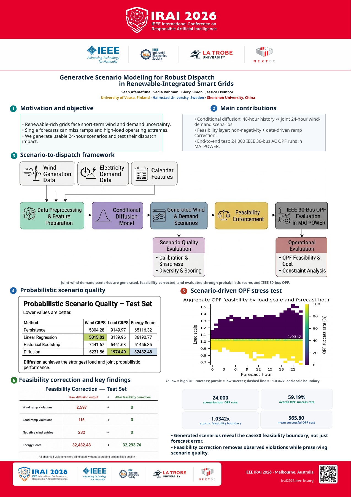
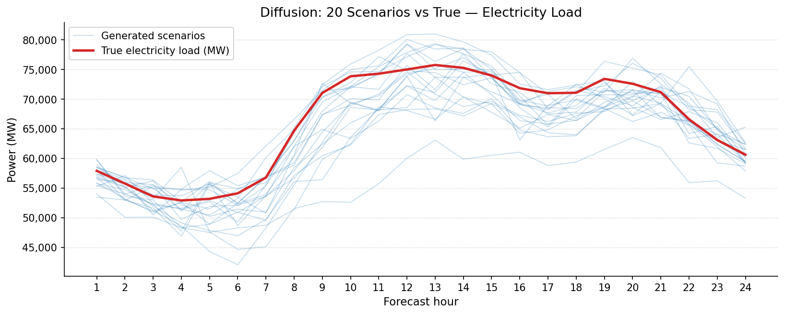
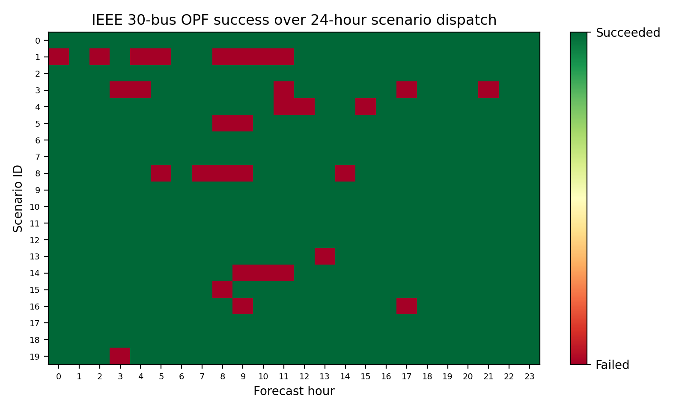

# Generative scenario modelling for renewable-grid dispatch

This repository contains the SynGrid team's code and results for **“Generative Scenario Modeling for Robust Dispatch in Renewable-Integrated Smart Grids.”** The work was developed for the **IEEE IES Generative AI Challenge 2026** and presented at **IEEE IRAI 2026** in Melbourne. The [conference poster](docs/IRAI2026_Presentation_Poster.pdf) names Sean Afamefuna, Sadia Rahman, Glory Simon, and Jessica Osunbor. This repository documents the modelling artifacts available from the supplied project archive.



The poster reports the later conference-stage study. Its **24,000 OPF runs and 59.19% success rate** are separate from the **480-run, 93.54% success-rate** dispatch subset whose scripts and results are included here. The 24,000-run outputs and the code used to produce that larger sweep were not in the supplied ZIP, so that poster result cannot be reproduced from this repository alone.

The question behind the project is practical: if tomorrow's wind generation and electricity demand are uncertain, how can we explore several plausible futures instead of relying on a single forecast? We trained a conditional diffusion model to generate paired, 24-hour wind and load scenarios from the preceding 48 hours of data. We then assessed the scenarios against simpler baselines, checked basic physical plausibility, and used their **load** trajectories to stress-test optimal power flow (OPF) on the IEEE 30-bus case.



## What is in the archive

| Folder | Contents |
| --- | --- |
| `src/` | Python data preparation, diffusion model, baseline comparisons, sampling, metrics, feasibility checks, and plotting |
| `dispatch/` | MATLAB/MATPOWER scripts for IEEE 30-bus OPF experiments |
| `data/processed/` | Cleaned hourly German wind/load series, chronological CSV splits, and saved normalization statistics |
| `checkpoints/` | Best normalized diffusion checkpoint from the archived run |
| `results/` | Recorded numerical results, scenario arrays for selected samples, and table exports |
| `figures/` | Figures generated during the project |
| `docs/` | IRAI 2026 presentation poster and original package notes |

The ZIP contained duplicate `submission_package/` copies of most code, plots, and tables. This layout keeps one copy of each, plus the later baseline and feasibility results from the root package. No new experimental result has been generated for this repository.

## Method and results

The data pipeline uses hourly German wind-generation and electricity-load observations from the OPSD dataset. Each example has 48 hours of history and a 24-hour target; target channels are **wind, then load**. The conditional diffusion model generates 20 joint trajectories for each evaluated window. The recorded probabilistic comparison covers **50 validation and 50 test windows**, with 20 scenarios per window. Lower scores are better.

| Test-set model | Wind CRPS | Load CRPS | Joint energy score |
| --- | ---: | ---: | ---: |
| Diffusion | 5,231.56 | **1,974.40** | **32,432.48** |
| Linear regression | **5,015.03** | 3,189.96 | 36,190.77 |
| Persistence | 5,804.28 | 9,149.97 | 65,116.32 |
| Historical sampling | 7,441.67 | 5,461.63 | 51,456.35 |

The historical-sampling results are in a separate comparison file; all four rows use the recorded 50-window evaluation. See [`probabilistic_metrics_comparison_50.csv`](results/probabilistic_metrics_comparison_50.csv) and [`historical_stochastic_baseline_comparison_50.csv`](results/historical_stochastic_baseline_comparison_50.csv). The diffusion model performs best here on load CRPS and the joint energy score, but linear regression has the better test wind CRPS.

The feasibility pass clips negative wind/load values and hourly changes above the 99th-percentile absolute ramps measured in the training targets. In the recorded 50-window test subset, it changes **232 negative wind entries and 2,597 wind-ramp violations to zero**, with test energy score changing from **32,432.48 to 32,293.74**. These are checks against chosen empirical limits, not proof that the trajectories meet every physical or network constraint. See [`ramp_feasible_probabilistic_metrics_comparison_50.csv`](results/ramp_feasible_probabilistic_metrics_comparison_50.csv).

For the dispatch experiment, generated **load** scenarios were turned into uniform load-scaling factors for MATPOWER's IEEE 30-bus case. Of **480 independent OPF runs** (20 scenarios × 24 hours), **449 succeeded and 31 failed**. The reported 93.54% is an **OPF success rate**, not a measure of forecast accuracy or guaranteed grid reliability. See [`case30_test_sample0_24h_dispatch_summary.csv`](results/case30_test_sample0_24h_dispatch_summary.csv).



## Running the code

Use Python with NumPy, pandas, PyTorch, SciPy, scikit-learn, and Matplotlib. The archive does not contain a tested environment lockfile, so exact package versions are not claimed. Run scripts from the repository root; for example:

```bash
python src/build_supervised_windows.py
python src/split_supervised_windows.py
python src/diffusion_data_prep.py
python src/normalize_diffusion_data.py
```

The cleaned hourly CSV and split CSVs are included, so these commands rebuild the larger NumPy training arrays that were left out of the public-ready package. `src/prepare_opsd_subset.py` is the earlier step for rebuilding these CSVs from the original OPSD `time_series_60min_singleindex.csv`; that raw source file is not bundled. Place it at `data/raw/` before running that step. Scripts that sample or evaluate the saved model require the rebuilt arrays and `checkpoints/diffusion_model_normalized_epoch_best.pt`. Training from scratch uses `python src/train_diffusion_normalized_long.py` after the preparation steps and needs substantially more compute.

Some source scripts belong to intermediate experiments, so the commands above describe the data setup, not a single-command reproduction of every archived figure and table. For example, `python src/plot_case30_24h_dispatch_success_heatmap.py` regenerates the displayed OPF heatmap from the included results CSV. The saved PyTorch checkpoint should be loaded only in a trusted environment because PyTorch checkpoint deserialization can execute code.

The MATLAB scripts require **MATPOWER 8.1**, as recorded in the original package notes, with MATPOWER on the MATLAB path. `dispatch/run_case30_24h_scenario_load_scales.m` reads `case30_test_sample0_24h_load_scales.csv` from MATLAB's current directory and writes its output there. The input CSV is included under `results/`; copy it into the MATLAB working directory before running the script. The script uses MATPOWER's `case30` and `runopf`.

## Scope and limitations

- The IEEE 30-bus experiment scales bus demand uniformly and solves each hour independently. It does **not** inject generated wind into the buses, schedule reserves, enforce capacity ceilings, or solve a coupled multi-period OPF.
- The feasibility adjustment enforces non-negativity and empirical ramp limits. It is not a complete physical or network-feasibility model.
- The large raw OPSD CSV and generated NumPy training arrays are omitted. The included processed hourly series is sufficient to rebuild the arrays with the listed scripts, but the unbundled raw file is needed to repeat the raw-data cleaning step.
- The source ZIP contains no manuscript, conference-stage 24,000-run outputs or reproduction code, formal publication link, or licence. The final conference poster was sourced separately from the team's presentation files. Team release permission has been confirmed, but no open-source licence is asserted here.

The original [`submission notes`](docs/original_submission_notes.txt) and [`additional results notes`](docs/additional_results_notes.txt) give more detail on what was available at each project milestone.
